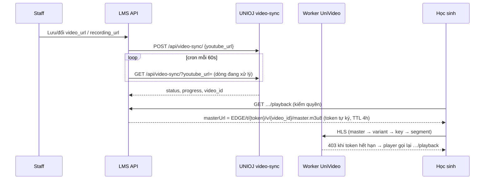

# Video bảo vệ — API

ADR: [`docs/adr/2026-10-18-protected-video-via-unioj-sync.md`](../adr/2026-10-18-protected-video-via-unioj-sync.md). Thuật ngữ: `CONTEXT.md` › *Video bảo vệ*.

Video tiết lý thuyết (`lessons.video_url`) và recording buổi học (`sessions.recording_url`) phát qua kho UniVideo (HLS mã hoá, Cloudflare Worker) thay cho YouTube nhúng. **Link YouTube không bao giờ tới trình duyệt học sinh.**

## Luồng

- Module: `apps/api/src/protected-video/` (`ProtectedVideoService`, `UniojVideoSyncClient`, `ProtectedVideoSyncJob`).
- Lưu link: `CourseLessonService.createLesson/updateLesson`, `SessionCreateService.createSession`, `SessionUpdateService.updateSession` gọi `track(url)` — fire-and-forget, lỗi UNIOJ không làm hỏng lưu tiết/buổi.
- Cron `EVERY_MINUTE`: gửi tối đa 20 dòng `pending` (mới nhất trước) rồi poll tối đa 50 dòng đang xử lý (cũ nhất trước). UNIOJ GET `404` → dòng về `pending` để gửi lại.
- Token: `b64url({"v":video_id,"tv":1,"exp"}) + "." + b64url(HMAC-SHA256(UNIVIDEO_TOKEN_SECRET, payload_b64))` — giống `UniVideo/src/shared/token.ts`.

## Endpoints học sinh

Cả hai trả `ProtectedVideoPlaybackDto`:

| `state` | Ý nghĩa | UI |
|---|---|---|
| `ready` | `masterUrl`, `expiresAt` (ISO) | Phát HLS |
| `processing` | `progress`: % tổng của UNIOJ, chỉ tăng (tải về 0, chuyển mã 0→89, tải lên 90); `null` khi bằng 0 (xếp hàng / đang tải về) hoặc lỗi chờ staff thử lại | «Video đang xử lý» |
| `unavailable` | Link không phải YouTube hoặc server thiếu `UNIVIDEO_*` | «Video không khả dụng» |
| `none` | Tiết/buổi không có video | Ẩn player |

### `GET /class/:classId/lessons/:lessonId/playback`

Role `student`. Cùng điều kiện mở tiết với `GET /class/:classId/lessons/:lessonId` (đang học lớp, lớp chưa hết hạn xem nội dung, tiết có trong lớp, không ẩn/lưu trữ, tiết thực hành chưa tới `openAt` → 403).

### `GET /class/:classId/timeline/sessions/:sessionId/playback`

Role `student`. Đang học lớp, lớp chưa hết hạn, buổi thuộc lớp và có dòng timeline. 404 nếu không.

### Response học sinh đã bỏ link YouTube

| Route | Field | Thay bằng |
|---|---|---|
| `GET /class/:classId/lessons`, `GET /class/:classId/lessons/:lessonId` (học sinh) | `videoUrl: null` | `hasVideo: boolean` |
| `GET /users/me/student-classes/:classId/lessons` (danh sách), `GET /users/me/student-classes/:classId/lessons/:lessonId` | `videoUrl: null` | `hasVideo` |
| `GET /courses/:courseId/modules/:moduleId/lessons[/:lessonId]` (khi role `student`) | `videoUrl: null` | `hasVideo` |
| `GET /class/:classId/timeline/student` | `session.recordingUrl: null` | `session.hasRecording` |
| `GET /users/me/student-classes/:classId/sessions` | `recordingUrl: null` | `hasRecording` |

Staff/admin vẫn nhận link gốc (xem trước bằng YouTube).

## Frontend

- Học sinh: `apps/web/components/ui/ProtectedVideoPlayer.tsx` (TanStack Query xin playback, `staleTime: Infinity` vì mỗi lần gọi là token mới → player nạp lại; `processing` hỏi lại 30 giây) + `ProtectedHlsPlayer.tsx` (Video.js v10 `@videojs/react`, `HlsJsVideo`, nạp qua `next/dynamic` `ssr: false`). Engine báo lỗi cuối (Worker `403` khi token hết hạn) → nhớ vị trí, xin link mới, phát tiếp; tối đa 1 lần / 20 giây để không lặp vô hạn. Mở DevTools → gỡ player.
- Staff: `apps/web/components/admin/ProtectedVideoSyncStatus.tsx` dưới ô link video (`TheoryLessonEditor`, `ClassContentManager`, form sửa buổi `SessionHistoryTable`): badge trạng thái của link **đã lưu** (hỏi lại 15 giây khi đang đồng bộ), nút **Thử lại** khi `failed`; ô nhập khác link đã lưu → nhắc «Lưu để bắt đầu đồng bộ».

## Endpoints staff

Role `admin` + staff `assistant`, `teacher`.

### `GET /protected-videos/status?url=<link YouTube>`

`ProtectedVideoStatusDto | null` (`null` nếu không phải link YouTube): `youtubeId`, `status` (`pending|queued|downloading|transcoding|uploading|ready|failed`), `progress`, `errorCode`, `lastSyncError`, `queuePosition`, `queueTotal`, `syncedAt`. Link chưa có dòng → `pending`.

### `POST /protected-videos/retry` — body `{ "url": "<link YouTube>" }`

Đưa dòng về `pending`, xoá lỗi, gửi lại UNIOJ ngay; trả trạng thái mới (hoặc `null`).

## Cấu hình

`apps/api/.env`: `UNIOJ_API_KEY` (khoá phải có quyền video sync), `UNIOJ_BASE_URL`, `UNIVIDEO_EDGE_URL`, `UNIVIDEO_TOKEN_SECRET` (trùng `TOKEN_SECRET` của VPS + Worker UniVideo). LMS **không** cần KEK.

## Vận hành

1. Điền env, `pnpm db:migrate` — migration `20261023100000_protected_videos` tự backfill mọi link YouTube cũ thành `pending`.
2. Cron gửi dần 20 link/phút (mới nhất trước); học sinh thấy «Video đang xử lý» tới khi `ready`.
3. Theo dõi: `SELECT status, count(*) FROM protected_videos GROUP BY 1;`
